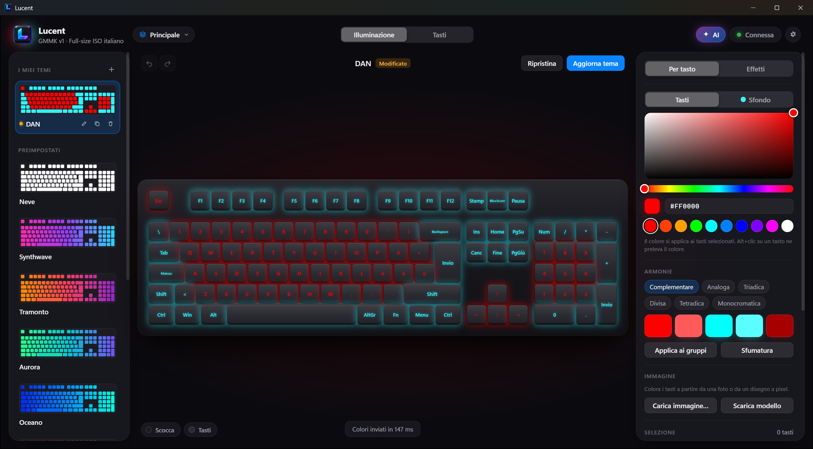
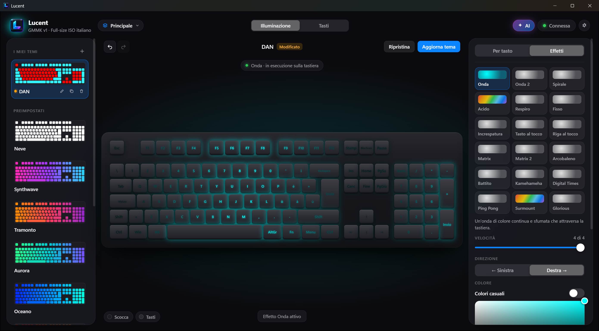
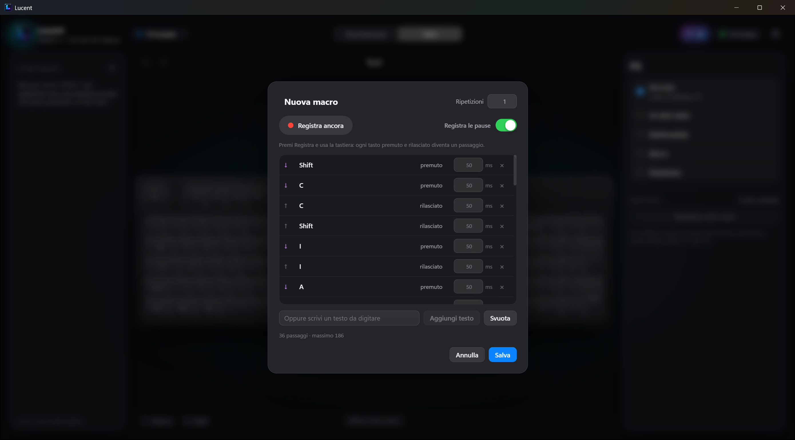

<div align="center">
  
  <h1>Lucent</h1>
  <strong>for GMMK v1</strong>
  <br>
  <i>Un'app curata e aperta per la tua GMMK v1: luci, tasti e macro, anche tramite AI.</i>
  <br>
</div>
<p></p>
<div align="center">

[![Stargazers][stars-shield]][stars-url]
[](https://github.com/d4N-87/Lucent/releases)
[![Issues][issues-shield]][issues-url]
[![MIT License][license-shield]][license-url]
[![LinkedIn][linkedin-shield]][linkedin-url]

</div>

<div align="center">

### ✨ [Scarica l'ultima versione / Download the latest release](https://github.com/d4N-87/Lucent/releases/latest) ✨

</div>

---

## 🖼️ Anteprima / Preview

| 🇮🇹 Illuminazione per tasto / 🇬🇧 Per-key lighting | 🇮🇹 Effetti / 🇬🇧 Effects | 🇮🇹 Tasti e macro / 🇬🇧 Keys and macros |
| :---: | :---: | :---: |
|  |  |  |

---

## 🇮🇹 Versione Italiana

### 📌 Cos'è Lucent?
**Lucent** è un'app per Windows che sostituisce il software ufficiale della **Glorious GMMK v1**. Colora ogni tasto, avvia gli effetti della tastiera, cambia la funzione dei tasti e salva le macro direttamente nella tastiera, con un'interfaccia pulita e comprensibile. Tutto è raccolto in **profili** che si cambiano con un clic.

È **portatile**: niente installazione. Profili e impostazioni restano nella cartella `data` accanto all'eseguibile.

### ⌨️ Tastiera supportata
**Glorious GMMK v1 full-size** (chip Sonix SN32F248B, USB `0C45:652F`).

Lucent è stata creata e provata su una GMMK v1 full-size **ISO italiana**. Le altre versioni della v1 hanno lo stesso chip e lo stesso USB, quindi dovrebbero funzionare, ma sono ancora **da verificare**.

| Versione | Stato |
| --- | --- |
| ISO italiano | ✅ Provata in ogni funzione |
| Altri ISO (spagnolo, tedesco, francese, UK…) | 🟡 Da verificare. Stessi tasti fisici: le scritte dell'anteprima e le macro scritte come testo seguono il layout di Windows. |
| ANSI (US) | 🟡 Da verificare. Si sceglie in Impostazioni › Tastiera › Formato (o in automatico con il layout US di Windows); finché non è verificata, tasti e macro si scrivono solo dopo il tuo permesso. |
| GMMK Pro, GMMK 2, GMMK 3 | ❌ Non supportate: usano chip e protocolli diversi. |

Hai una GMMK v1 con un altro layout? Prova Lucent e raccontaci com'è andata in una [issue](https://github.com/d4N-87/Lucent/issues): con un file del modello si può aggiungere il tuo layout ([docs/nuova-tastiera.md](docs/nuova-tastiera.md)).

### 🚀 Caratteristiche
- **Colori per tasto:** selettore colore, armonie, sfumature, gruppi pronti (WASD, frecce, tastierino…), colori presi da un'immagine.
- **La tua tastiera, la tua lingua:** l'anteprima mostra le scritte del layout di Windows (italiano, spagnolo, tedesco, US…) nel formato ISO o ANSI, e le macro scritte come testo premono i tasti giusti per quel layout.
- **18 effetti hardware** con anteprima animata: velocità, direzione e colore.
- **Temi:** preimpostati e tuoi, con Indietro/Avanti per ogni modifica.
- **Profili illimitati** (colori + funzioni dei tasti + macro), esportabili e importabili come file.
- **Tasti:** ogni tasto può diventare un altro tasto, un tasto multimediale, una macro o essere disattivato.
- **Macro salvate nella tastiera**, quindi funzionano anche senza l'app e su altri PC. Si registrano dalla tastiera o si scrivono come testo (fino a 17 macro).
- **Frequenza USB** da 125 a 1000 Hz.
- **Controllo tramite AI (MCP):** un assistente come Claude può leggere e comandare la tastiera.
- Avvio con Windows nella tray, riconnessione automatica, tema chiaro/scuro, italiano e inglese (altre lingue con un file in `lang`).

### 🛠️ Come si usa
1. Scarica lo zip dalla pagina [Releases](https://github.com/d4N-87/Lucent/releases/latest) ed estrailo in una cartella a tua scelta: dentro c'è l'app già pronta, niente da compilare. Serve Windows 10 o 11 a 64 bit.
2. Chiudi il software ufficiale Glorious, così i due programmi non si contendono la tastiera.
3. Avvia `lucent.exe`. L'eseguibile non è firmato, quindi Windows può mostrare *"PC protetto da Windows"*: premi **Ulteriori informazioni → Esegui comunque**. Il codice è tutto qui, se vuoi controllarlo.
4. Scegli un tema o colora i tasti: le modifiche arrivano subito alla tastiera e si salvano da sole nel profilo attivo.

Prima di scrivere per la prima volta tasti o macro, Lucent salva una copia di quelli della tastiera in `data\backup`.

### 🤖 Controllo tramite AI (MCP)
Lucent include un server [MCP](https://modelcontextprotocol.io) locale: un assistente AI può colorare tasti, avviare effetti, cambiare profilo o creare macro con frasi come *"fammi un tramonto con WASD in rosso"*.

1. In Lucent premi **AI** in alto a destra e accendi il server. Ascolta solo su questo PC, all'indirizzo `http://127.0.0.1:46327/mcp`.
2. Collega il tuo client (Lucent deve restare aperto):

| Client | Come collegarlo |
| --- | --- |
| Claude Code | `claude mcp add --transport http lucent http://127.0.0.1:46327/mcp` |
| Claude Desktop | in `claude_desktop_config.json`: `"mcpServers": { "lucent": { "command": "npx", "args": ["mcp-remote", "http://127.0.0.1:46327/mcp"] } }` (serve [Node.js](https://nodejs.org)) |
| Codex CLI (OpenAI) | `codex mcp add lucent --url http://127.0.0.1:46327/mcp` |
| Gemini CLI | in `~/.gemini/settings.json`: `"mcpServers": { "lucent": { "httpUrl": "http://127.0.0.1:46327/mcp" } }` |
| VS Code (Copilot) | in `.vscode/mcp.json`: `"servers": { "lucent": { "type": "http", "url": "http://127.0.0.1:46327/mcp" } }` |
| Cursor | in `~/.cursor/mcp.json`: `"mcpServers": { "lucent": { "url": "http://127.0.0.1:46327/mcp" } }` |
| Altri | un server MCP di tipo HTTP (Streamable HTTP) con lo stesso indirizzo |

ChatGPT si collega solo a server raggiungibili da internet, mentre Lucent per sicurezza risponde solo al tuo PC: non esporlo con un tunnel, chiunque potrebbe comandare la tastiera.

Le modifiche dell'AI compaiono dal vivo e si annullano come le tue. Elenco degli strumenti: [docs/mcp.md](docs/mcp.md).

### 🔒 Perché niente firmware personalizzato (QMK)?
Il firmware QMK/SonixQMK permetterebbe molto di più, ma sulla GMMK v1 oggi non è una strada sicura:
- **Non esiste un port** di SonixQMK per la GMMK v1 full-size.
- **Il firmware originale non si può salvare** senza aprire la tastiera e collegare un programmatore SWD (es. ST-Link). Senza quella copia non si torna indietro.
- **Se un aggiornamento va male**, per recuperarla bisogna aprirla e usare il pin BOOT della scheda.

Per questo Lucent parla con il **firmware originale**, usando lo stesso protocollo USB dell'app ufficiale ([docs/protocollo.md](docs/protocollo.md)), e non tocca mai il firmware né il bootloader.

### 🧑‍💻 Compilare dal codice
Servono [Rust](https://rustup.rs) e [Node.js](https://nodejs.org).
```bash
npm install
npx tauri build --no-bundle
```
L'eseguibile è in `target\release\lucent.exe`.

---

## 🇬🇧 English Version

### 📌 What is Lucent?
**Lucent** is a Windows app that replaces the official software of the **Glorious GMMK v1**. It colors every key, runs the keyboard's built-in effects, remaps keys and stores macros right in the keyboard, with a clean interface that is easy to understand. Everything lives in **profiles** you switch with one click.

It is **portable**: nothing to install. Profiles and settings stay in the `data` folder next to the executable.

### ⌨️ Supported keyboard
**Glorious GMMK v1 full-size** (Sonix SN32F248B chip, USB `0C45:652F`).

Lucent was built and tested on an **Italian ISO** GMMK v1 full-size. The other v1 versions share its chip and USB ids, so they should work, but they are still **to be verified**.

| Version | Status |
| --- | --- |
| Italian ISO | ✅ Every feature tested |
| Other ISO (Spanish, German, French, UK…) | 🟡 To be verified. Same physical keys: preview legends and macros written as text follow the Windows layout. |
| ANSI (US) | 🟡 To be verified. Pick it in Settings › Keyboard › Shape (or automatically with the US Windows layout); until it's verified, keys and macros are written only after you allow it. |
| GMMK Pro, GMMK 2, GMMK 3 | ❌ Not supported: they use different chips and protocols. |

Got a GMMK v1 with another layout? Try Lucent and tell us how it went in an [issue](https://github.com/d4N-87/Lucent/issues): a model file can add your layout ([docs/nuova-tastiera.md](docs/nuova-tastiera.md), in Italian).

### 🚀 Features
- **Per-key colors:** color picker, harmonies, gradients, ready-made groups (WASD, arrows, numpad…), colors taken from an image.
- **Your keyboard, your language:** the preview shows the legends of your Windows layout (Italian, Spanish, German, US…) in ISO or ANSI shape, and macros written as text press the right keys for that layout.
- **18 hardware effects** with an animated preview: speed, direction and color.
- **Themes:** presets and your own, with Undo/Redo for every change.
- **Unlimited profiles** (colors + key functions + macros), exported and imported as files.
- **Keys:** any key can become another key, a media key or a macro, or be turned off.
- **Macros stored in the keyboard**, so they work without the app and on other PCs. Record them on the keyboard or type them as text (up to 17 macros).
- **USB report rate** from 125 to 1000 Hz.
- **AI control (MCP):** an assistant such as Claude can read and drive the keyboard.
- Start with Windows in the tray, automatic reconnection, light/dark appearance, English and Italian (more languages with a file in `lang`).

### 🛠️ How to use
1. Download the zip from the [Releases](https://github.com/d4N-87/Lucent/releases/latest) page and extract it into a folder of your choice: the app inside is ready to run, nothing to build. Requires 64-bit Windows 10 or 11.
2. Close the official Glorious software, so the two programs don't fight over the keyboard.
3. Run `lucent.exe`. The executable is not signed, so Windows may show *"Windows protected your PC"*: click **More info → Run anyway**. All the code is here if you want to check it.
4. Pick a theme or color the keys: changes reach the keyboard right away and save themselves in the active profile.

Before writing keys or macros for the first time, Lucent saves a copy of the keyboard's own in `data\backup`.

### 🤖 AI control (MCP)
Lucent includes a local [MCP](https://modelcontextprotocol.io) server: an AI assistant can color keys, start effects, switch profiles or create macros from requests like *"give me a sunset with WASD in red"*.

1. In Lucent click **AI** at the top right and turn the server on. It listens only on this PC, at `http://127.0.0.1:46327/mcp`.
2. Connect your client (Lucent must stay open):

| Client | How to connect it |
| --- | --- |
| Claude Code | `claude mcp add --transport http lucent http://127.0.0.1:46327/mcp` |
| Claude Desktop | in `claude_desktop_config.json`: `"mcpServers": { "lucent": { "command": "npx", "args": ["mcp-remote", "http://127.0.0.1:46327/mcp"] } }` (needs [Node.js](https://nodejs.org)) |
| Codex CLI (OpenAI) | `codex mcp add lucent --url http://127.0.0.1:46327/mcp` |
| Gemini CLI | in `~/.gemini/settings.json`: `"mcpServers": { "lucent": { "httpUrl": "http://127.0.0.1:46327/mcp" } }` |
| VS Code (Copilot) | in `.vscode/mcp.json`: `"servers": { "lucent": { "type": "http", "url": "http://127.0.0.1:46327/mcp" } }` |
| Cursor | in `~/.cursor/mcp.json`: `"mcpServers": { "lucent": { "url": "http://127.0.0.1:46327/mcp" } }` |
| Others | an HTTP (Streamable HTTP) MCP server at the same address |

ChatGPT only connects to servers reachable from the internet, while Lucent answers only your own PC on purpose: don't expose it through a tunnel, or anyone could drive your keyboard.

The AI's changes show up live and can be undone like yours. Tool list: [docs/mcp.md](docs/mcp.md) (in Italian; the tools describe themselves in English).

### 🔒 Why no custom firmware (QMK)?
QMK/SonixQMK firmware would allow much more, but on the GMMK v1 it is not a safe path today:
- **There is no SonixQMK port** for the GMMK v1 full-size.
- **The original firmware can't be backed up** without opening the keyboard and wiring an SWD programmer (e.g. ST-Link). Without that copy there is no way back.
- **If a flash goes wrong**, recovering it means opening it and using the board's BOOT pin.

So Lucent talks to the **original firmware**, using the same USB protocol as the official app ([docs/protocollo.md](docs/protocollo.md)), and never touches the firmware or the bootloader.

### 🧑‍💻 Build from source
You need [Rust](https://rustup.rs) and [Node.js](https://nodejs.org).
```bash
npm install
npx tauri build --no-bundle
```
The executable is in `target\release\lucent.exe`.

---

## ⚠️ Nota / Disclaimer

<p>🇮🇹 Lucent è un progetto indipendente, non affiliato né approvato da Glorious. GMMK e Glorious sono marchi dei rispettivi proprietari. Lo usi a tuo rischio: Lucent scrive nella memoria della tastiera colori, tasti e macro, ma mai il firmware.</p>
<p>🇬🇧 Lucent is an independent project, not affiliated with or endorsed by Glorious. GMMK and Glorious are trademarks of their respective owners. Use it at your own risk: Lucent writes colors, keys and macros to the keyboard's memory, but never its firmware.</p>

## ❤️ Supporta il Progetto / Support the Project

<p>🇮🇹 Se Lucent ti è stato utile, considera di supportare il progetto. Ogni contributo aiuta a sviluppare nuove funzioni e a supportare altre tastiere!</p>
<p>🇬🇧 If you found Lucent useful, please consider supporting the project. Every contribution helps build new features and support more keyboards!</p>

<p align="center">
  <a href="https://www.patreon.com/d4N87" target="_blank"></a>
  &nbsp;
  <a href="https://paypal.me/d4n87?country.x=IT&locale.x=it_IT" target="_blank"></a>
</p>

# Star History

[](https://www.star-history.com/#d4N-87/Lucent&Date)

---

## 📄 Licenza / License

<p>🇮🇹 Questo progetto è rilasciato sotto la <a href="LICENSE">Licenza MIT</a>.</p>
<p>🇬🇧 This project is released under the <a href="LICENSE">MIT License</a>.</p>

<!-- Link di Riferimento per i Badge (vanno alla fine del file) -->
[stars-shield]: https://img.shields.io/github/stars/d4N-87/Lucent?style=for-the-badge
[stars-url]: https://github.com/d4N-87/Lucent/stargazers
[issues-shield]: https://img.shields.io/github/issues/d4N-87/Lucent?style=for-the-badge
[issues-url]: https://github.com/d4N-87/Lucent/issues
[license-shield]: https://img.shields.io/github/license/d4N-87/Lucent?style=for-the-badge
[license-url]: https://github.com/d4N-87/Lucent/blob/HEAD/LICENSE
[linkedin-shield]: https://img.shields.io/badge/-LinkedIn-black.svg?style=for-the-badge&logo=linkedin&colorB=555
[linkedin-url]: https://www.linkedin.com/in/danielenofi
